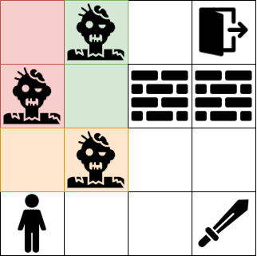
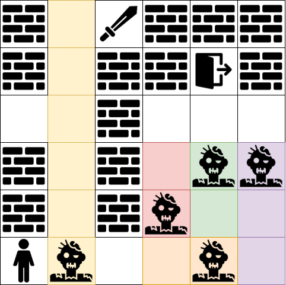
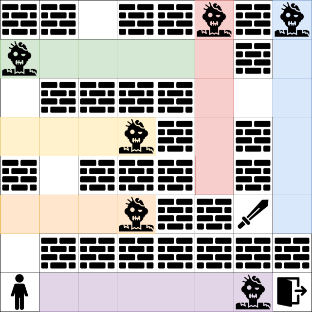

# 🎮 Analyzing the Impact of Domain Features on Heuristic Search Performance

A classical AI planning project investigating how different domain features influence heuristic search performance in grid-based environments. Using **PDDL** and **Fast Downward**, the project models game-inspired mechanics and evaluates their impact on automated planning.

## 🧩 Project Overview

The domain includes mechanics such as walls, zombies, portals, keys and doors, fireballs, and swords. Planning instances of varying difficulty are used to investigate how these features affect search performance.

## 🗺️ Example Levels

Examples of the grid-based levels used in the experiments, illustrating the different layouts and difficulty settings.

<table>
  <tr>
    <td align="center" width="33%">
      <strong>Easy</strong> 
      
    </td>
    <td align="center" width="33%">
      <strong>Medium</strong> 
      
    </td>
    <td align="center" width="33%">
      <strong>Hard</strong> 
      
    </td>
  </tr>
</table>

## 🛠️ Technologies

- **PDDL** — domain and problem modeling
- **Fast Downward** — automated planning and heuristic search

## 📄 Paper

For the full methodology, experimental setup, results, and discussion, see the accompanying paper:

[📖 Read the paper](paper/analyzing-domain-features-heuristic-search.pdf)

## 🚀 Getting Started

Explore the PDDL domain definition and problem instances to see how the planning environment is modeled. Refer to the paper for details about the experiments and evaluation.
